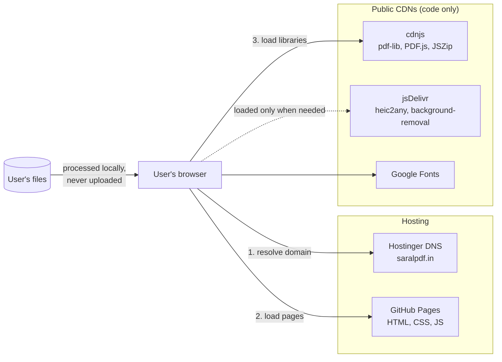
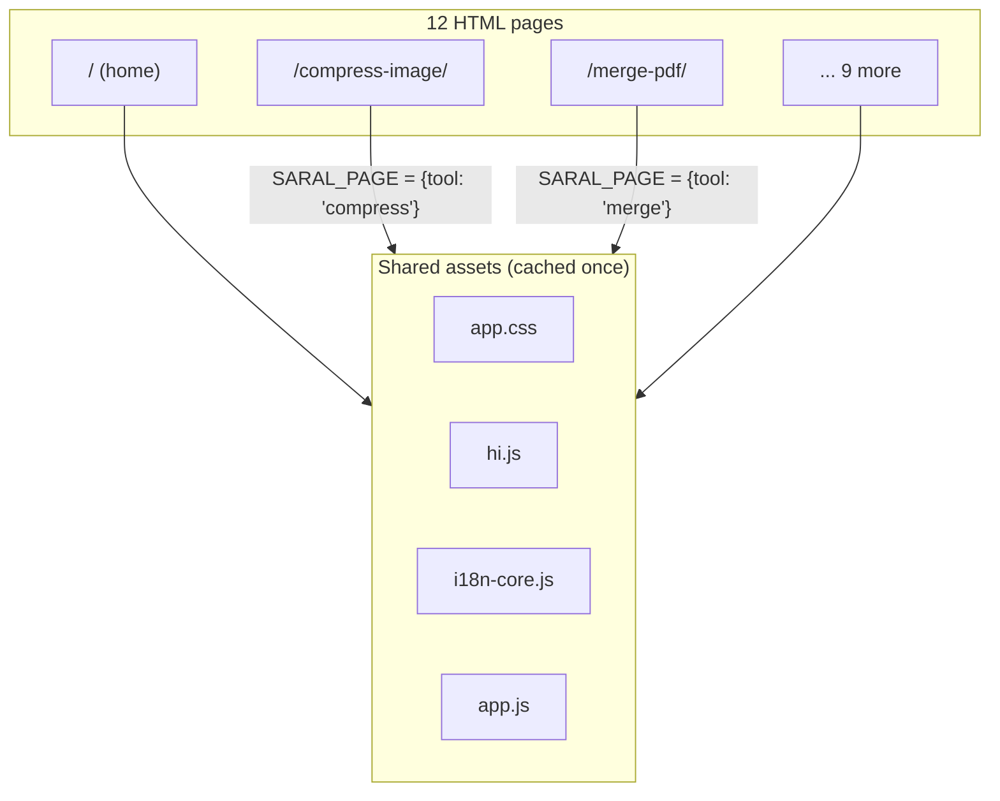
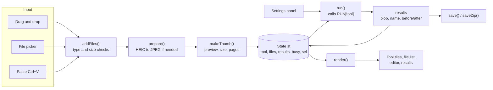
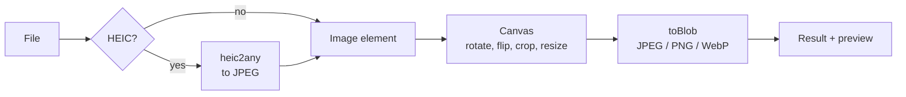
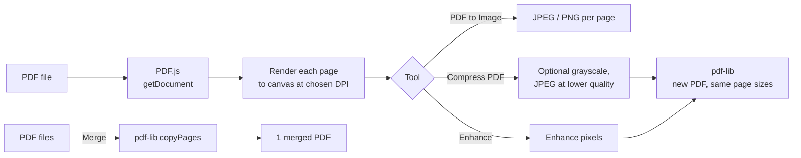
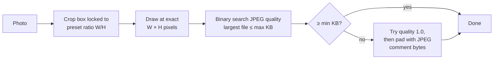
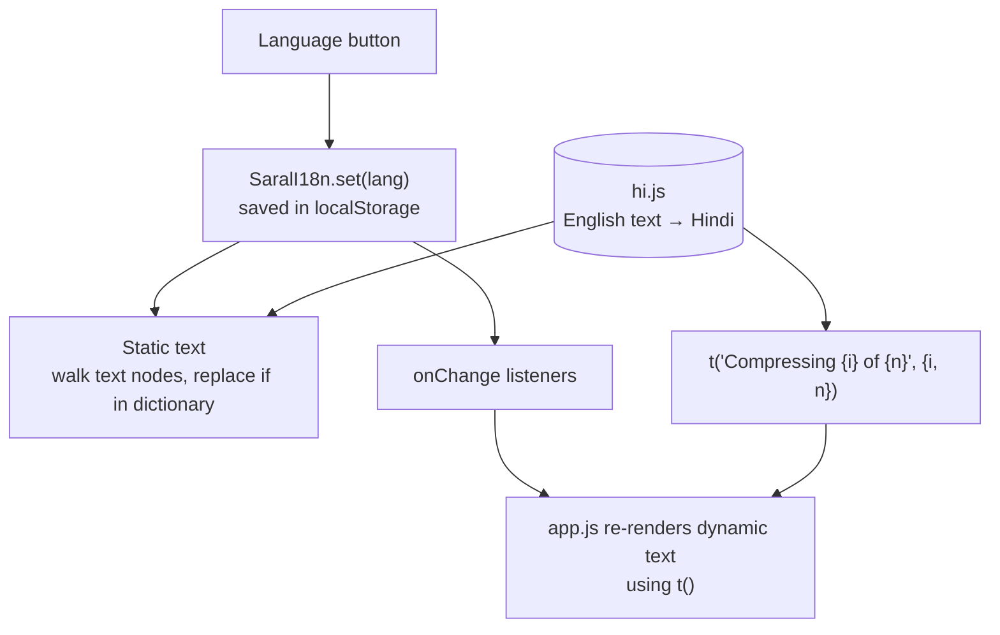
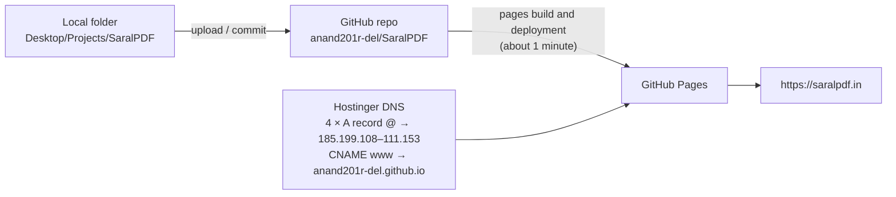

# SaralPDF Architecture

SaralPDF is a static website. There is no backend server and no database. Every PDF and image operation runs inside the visitor's browser, so files never leave their device.

Live site: https://saralpdf.in

## Contents

1. [System overview](#1-system-overview)
2. [Repository structure](#2-repository-structure)
3. [Page model](#3-page-model)
4. [Application design](#4-application-design)
5. [Processing pipelines](#5-processing-pipelines)
6. [Key algorithms](#6-key-algorithms)
7. [Language switch (English / Hindi)](#7-language-switch-english--hindi)
8. [Privacy and security](#8-privacy-and-security)
9. [Deployment](#9-deployment)
10. [SEO](#10-seo)
11. [Design decisions and trade-offs](#11-design-decisions-and-trade-offs)

---

## 1. System overview



| Layer | Technology |
|---|---|
| Hosting | GitHub Pages (free, HTTPS) |
| Domain | saralpdf.in, registered at Hostinger, A and CNAME records point to GitHub Pages |
| Front end | Plain HTML, CSS and JavaScript (no framework, no build step needed to run) |
| PDF engine | pdf-lib 1.17.1 (create and merge), PDF.js 3.11.174 (read and render) |
| Image engine | Canvas API, heic2any (iPhone photos) |
| AI | @imgly/background-removal 1.5.8 (ONNX IS-Net model on WebAssembly) |
| Packaging | JSZip 3.10.1 |

---

## 2. Repository structure

```
SaralPDF/
├── index.html                  Home page (all tools)
├── image-to-pdf/index.html     ┐
├── merge-pdf/index.html        │
├── compress-pdf/index.html     │
├── pdf-to-image/index.html     │
├── compress-image/index.html   │  One page per tool.
├── resize-image/index.html     │  Same app, different title, description,
├── crop-image/index.html       │  heading, how-to steps and FAQ.
├── exam-photo-signature/...    │
├── convert-image/index.html    │
├── enhance/index.html          │
├── remove-background/index.html┘
├── assets/
│   ├── app.js          The application (all tools)
│   ├── app.css         Styles for tool pages
│   ├── i18n-core.js    Language switch engine
│   ├── hi.js           Hindi translations
│   └── site.css        Styles for content pages
├── guides/             Six how-to articles + index
├── about/  privacy/  terms/  contact/
├── sitemap.xml  robots.txt  site.webmanifest
├── favicon.ico  favicon-48.png  apple-touch-icon.png  icon-192.png  icon-512.png
├── README.md
└── ARCHITECTURE.md
```

---

## 3. Page model

Every tool page loads the **same** `app.js`. The only difference is a one-line setting that tells the app which tool to open first.



Script load order on each page:

1. `hi.js` defines the Hindi dictionary.
2. `i18n-core.js` exposes `SaralI18n.t()` and the language button.
3. pdf-lib, JSZip, PDF.js from cdnjs.
4. `window.SARAL_PAGE = {tool: "..."}` (tool pages only).
5. `app.js` starts the app.

**Switching tools without reloading.** Tool tiles are real links (`<a href="/merge-pdf/">`), so they work without JavaScript and search engines can follow them. When JavaScript is running, a click is intercepted: the app switches tool in place, keeps compatible files, and updates the address bar with `history.pushState`. The browser Back button is handled through `popstate`.

---

## 4. Application design

`app.js` is a single module (an IIFE) organised around one state object and a render function.



### State

```js
st = {
  tool:    "compress",   // active tool key
  files:   [ { id, file, name, size, kind, img, w, h, pages,
               rot, flip, crop, sample, bad, converted } ],
  results: { items: [ { name, blob, before, dims, note, preview } ],
             label, compare, zipName },
  busy:    false,        // true while processing
  sel:     12            // file shown in the crop editor
}
```

### Tool registry

Each tool is one entry in `TOOLS` (name, accepted file kind, button text, minimum files, whether it supports reordering or the crop editor) and one function in `RUN`. Adding a new tool means adding one entry, one function and one settings panel.

| Key | Accepts | Runner | Output |
|---|---|---|---|
| `img2pdf` | images | `runImg2Pdf` | 1 PDF |
| `merge` | PDFs | `runMerge` | 1 PDF |
| `pdfcompress` | PDFs | `runPdfCompress` | PDF per input |
| `pdf2img` | PDFs | `runPdf2Img` | JPG/PNG per page |
| `compress` | images | `runCompress` | image per input |
| `resize` | images | `runResize` | image per input |
| `crop` | images | `runCrop` | image per input |
| `exam` | images | `runExam` | JPG per input |
| `convert` | images | `runConvert` | image per input |
| `enhance` | images + PDFs | `runEnhance` | image or PDF per input |
| `bgremove` | images | `runBgRemove` | PNG/JPG per input |

### Error handling

- Wrong file type, files over 50 MB and unreadable or password-protected PDFs are rejected with a plain message instead of failing silently.
- One bad file in a batch is skipped and reported; the rest are still processed.
- Heavy loops yield to the browser (`await tick()`) between pages and files, so the progress bar keeps updating.

---

## 5. Processing pipelines

### Image tools



### PDF tools



### Exam Photo & Signature



### Remove Background

The AI library (about 40 MB for the fast model, 80 MB for the best) is imported only when this tool runs. The browser caches the model after the first download. Inference runs on WebAssembly on the user's device.

---

## 6. Key algorithms

### Compress to an exact KB size

JPEG file size grows with quality, so the app binary-searches the quality value:

```
lo = 0.05, hi = 0.95
repeat 7 times:
    q = (lo + hi) / 2
    size = encode(canvas, q)
    if size ≤ target: best = q; lo = q     # try higher quality
    else:             hi = q               # too big, go lower
```

Seven steps narrow quality to within about 1%. If even the lowest quality is too big, the image is scaled down by 20% and the search repeats (up to 10 rounds). For exam files the pixel size is fixed, so only quality changes.

### Reaching a minimum KB (exam forms)

Some forms reject files that are too small (for example under 20 KB). Very simple images can encode smaller than that even at the highest quality. The app inserts JPEG **comment segments** (marker `FF FE`) right after the start-of-image marker. Image viewers ignore comments, so the picture is unchanged but the file reaches the required size.

### Crop editor

- Crop rectangles are stored **normalised** (0 to 1) relative to the rotated image, so they stay correct at any screen size.
- With a fixed ratio, the stored ratio is converted to normalised units (`ratio × H / W`) and enforced while dragging corners.
- The darkened area outside the crop is a box shadow inside a clipped layer, while the handles sit in a separate unclipped layer so they remain grabbable at the image edges.
- Pointer events with pointer capture work the same for mouse, touch and pen.

### Enhance Quality (no AI)

| Step | Photo | Document |
|---|---|---|
| Shadow removal | – | Estimate background: downscale 24×, 3× max-filter, upscale; divide each pixel by it |
| Colour | Saturation boost | Grayscale (or keep colour) |
| Contrast | Percentile levels stretch | Stronger percentile stretch |
| Sharpen | Laplacian kernel | Laplacian kernel |
| Black and white | – | Otsu automatic threshold |

### Privacy side effect

Images are re-drawn from pixels onto a canvas before saving, so EXIF data such as GPS location is not copied to the output.

---

## 7. Language switch (English / Hindi)



- **English text is the key.** There are no separate key names to maintain; untranslated text simply stays in English.
- **Static text** in the HTML is translated by walking the page's text nodes. The original English is kept in a `WeakMap`, so switching back restores it exactly.
- **Dynamic text** (progress, results, errors) is produced through `t()`, which also fills placeholders like `{name}` and `{n}`.
- Areas that the app redraws itself are excluded from the walker to avoid double work.
- The choice is remembered with `localStorage`; first-time visitors whose browser language is Hindi start in Hindi.
- A coverage check during development compares every visible string and every `t()` call against `hi.js`, and verifies that placeholders match.

---

## 8. Privacy and security

| Concern | Approach |
|---|---|
| User files | Read with the File API and processed in memory. No network request ever contains file data. |
| Third parties | Only code is loaded from CDNs (pinned versions). Google Fonts receives standard request data. |
| Tracking | No analytics and no cookies. |
| Contact email | Assembled in JavaScript so simple scrapers can't read it from the HTML. |
| Untrusted file names | Escaped before being inserted into the page (`esc()`). |
| HTTPS | Enforced by GitHub Pages for saralpdf.in. |

---

## 9. Deployment



- The `CNAME` file in the repo holds `saralpdf.in`.
- Shared files are referenced with a version query (`app.js?v=3`); increasing it after an update makes browsers fetch the new file.
- To run locally: `python -m http.server 8000` in the project folder, then open http://localhost:8000.

---

## 10. SEO

- One page per tool with a unique `<title>`, meta description, H1, how-to steps and FAQ.
- Structured data (JSON-LD): `WebApplication`, `FAQPage` and `BreadcrumbList` on tool pages; `Article` on guides.
- `sitemap.xml` lists all 23 pages; `robots.txt` points to it. The site is verified in Google Search Console.
- Canonical URLs, Open Graph tags, favicon and web app manifest on every page.
- Guides link to the matching tool pages, and tool pages link back to guides.

---

## 11. Design decisions and trade-offs

| Decision | Why | Trade-off |
|---|---|---|
| Client-side processing only | Privacy, zero server cost, works for any number of users | Limited by the user's device memory; no text-preserving PDF compression (needs Ghostscript on a server) |
| No framework, no build step | Fast to load, easy to host anywhere, easy to read | More manual DOM code |
| One shared app for all tool pages | One codebase, browser caches assets once | Every page includes all settings panels (small extra HTML) |
| Links plus `pushState` for tool tiles | Crawlable URLs and instant switching that keeps files | Extra code for Back button handling |
| Libraries from CDNs, pinned versions | Smaller repo, shared browser cache | Site depends on CDN availability |
| Lazy-loading heavy libraries | Pages open fast on mobile data | First use of HEIC or background removal waits for a download |
| Compressed PDF pages saved as images | Big size savings on scans | Text is no longer selectable |

### Possible next steps

- Web Workers for heavy pixel work so the page never pauses on large files.
- PWA service worker so tools work offline after the first visit.
- Split, rotate and delete PDF pages.
- Hindi versions of the guides at `/hi/guides/...` with `hreflang` links.
- Optional backend (Ghostscript, LibreOffice) for text-preserving compression and Word ↔ PDF.
